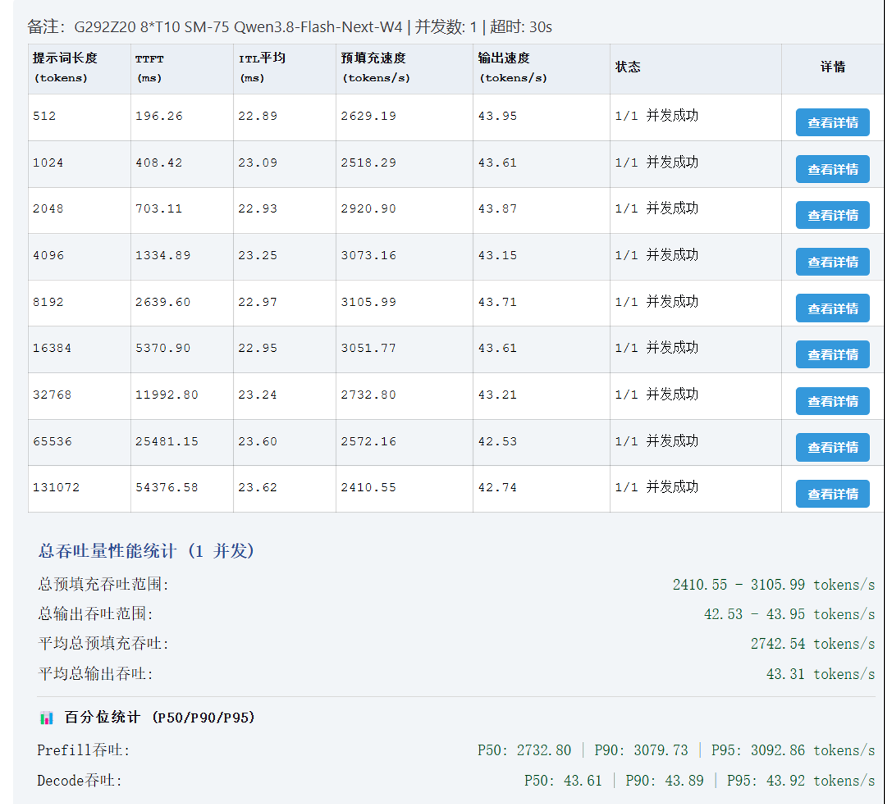
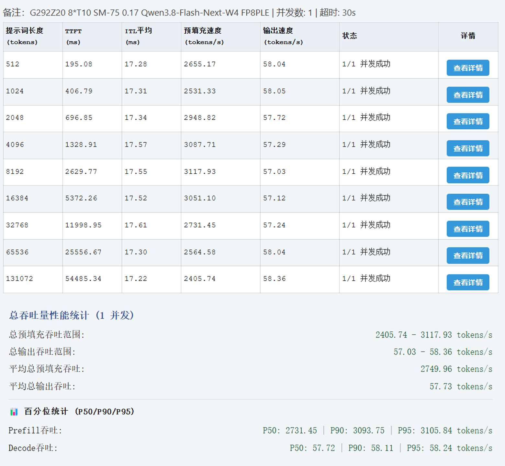
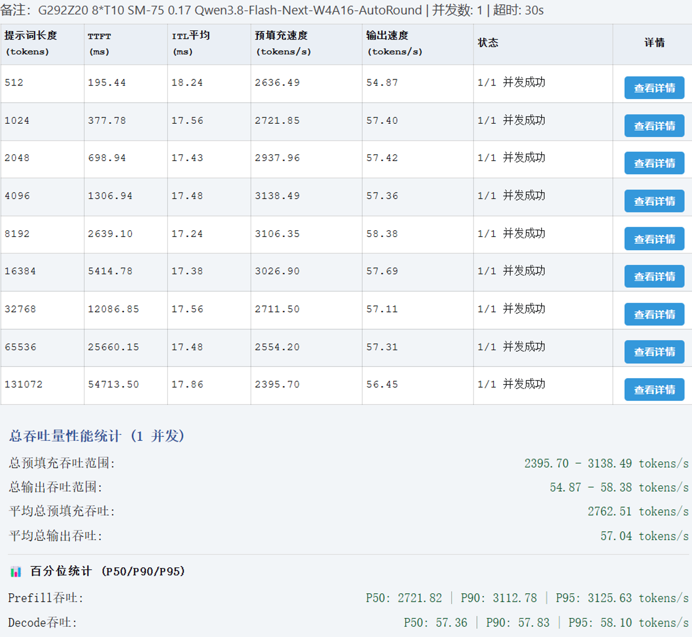

# vLLM-SM75 v0.1.7 beta2


## 0. This repo also carries a second delivery line: GPUStack backend (start here for that)

On top of upstream VLLM-SM75, this repo adds a line that runs the SM75 build of vLLM as a
**custom GPUStack backend**. If that is what you want, skip section 5 below (that is the
panel/Ultra form) and go to:

- Step-by-step (clone, probe & build, start server/worker, register the backend version, deploy, four acceptance gates): `gpustack/run-book-v1.md`
- The two paste blocks for the form: `gpustack/args-paste-v1.txt` (24 lines) and `gpustack/env-paste-v1.txt` (**25 lines**; line 25 `GPUSTACK_MODEL_VRAM_CLAIM` is mandatory — without it the model queues forever with no error)
- Why each parameter is set this way and how to re-derive it for other hardware: `gpustack/backend-version-card-v1.md`, `gpustack/compat-matrix-v1.md`

These two README sections are the only deliberate edits made to upstream-frozen files;
their new digests are updated in place in `gpustack/SHA256SUMS-upstream.txt` and logged in NOTICE section 3.

[中文](README.md) · [Release notes](docs/releases/v0.1.7-beta2.md) · [Model profiles](docs/configuration-v0.1.7.md) · [BenchLocal](docs/benchlocal.md)

## 0.5 Measured performance (same machine, same ruler)

Harness: BenchLocal, **concurrency 1, timeout 30 s, nine prompt lengths 512 → 131072**, all `1/1 success`.
Hardware: `G292Z20 8*T10 SM-75`. The caption under each image is the harness note verbatim.

### Test configuration (identical across all three runs)

Tool: **Prefill & Decode benchmark v3 (chao mod)** — the benchmark harness shipped inside this image.

| Field | Value | Field | Value |
| --- | --- | --- | --- |
| Min prompt length | 512 | Max prompt length | 131072 |
| Step | 128 | Step multiplier | 2 (exponential: 128→256→512→…1024…) |
| Expected output length | **1024** | Concurrency | 1 |
| Request timeout | 30000 ms | Temperature | 1 |
| Top P | 0.95 | Presence Penalty | 0 |
| Frequency Penalty | 0 | | |

### Bare upstream baseline (none of this repo's optimization layers)



Note `G292Z20 8*T10 SM-75 Qwen3.8-Flash-Next-W4` | mean total output **43.31 tok/s** | mean prefill 2742.54 tok/s | ITL 22.89-23.62 ms

### Optimized model 1: FP8PLE



Note `G292Z20 8*T10 SM-75 0.17 Qwen3.8-Flash-Next-W4 FP8PLE` | mean total output **57.73 tok/s** | mean prefill 2749.96 tok/s | ITL 17.22-17.61 ms

### Optimized model 2: W4A16-AutoRound



Note `G292Z20 8*T10 SM-75 0.17 Qwen3.8-Flash-Next-W4A16-AutoRound` | mean total output **57.04 tok/s** | mean prefill 2762.51 tok/s | ITL 17.24-18.24 ms

**How to read these three (scope confirmed by the maintainer, not inferred here)**: the first and second runs are **the same model, FP8PLE** — the first is the bare upstream `v0.1.7-beta2` with none of this repo's optimization layers applied; the harness note says `W4` but the actual checkpoint is FP8PLE, and this sentence is authoritative. So **43.31 → 57.73 is a same-model comparison = +33.3% on output**, while mean prefill barely moves (2742.54 vs 2749.96) ⇒ **this repo's optimization layers pay off on decode, not prefill**. The third run, `W4A16-AutoRound`, is a different model with **no paired bare-upstream baseline** — do not express it as a percentage against the first two. Also: in the third table the 512 cell (54.87, ITL 18.24) is a cold-start outlier, not steady state.

## 1. Overview

vLLM 0.30.0 adapted for NVIDIA Turing / SM75, including Tesla T4 and T10. Supports Qwen3.8 27B FP8 / AWQ / NVFP4 and Flash Next W4A16, with GDN, FP8 KV, MTP, DFlash2, DSpark, Firefly, CPU KV, power management and monitoring.

Use one image: **`vllm-sm75:v0.1.7-ultra-beta2`**. Ultra includes the console, chat workspace and model tests. Set `SM75_EDITION=standard` to run only the inference API using the same model profiles and engine.

QQ community: **878924874**.

## 2. Updates

- DSpark k5 profiles for 27B FP8 / NVFP4, draft KV grouping and graph capture support.
- Prefix cache configuration, CPU KV shared-memory checks and LMCache configuration hints.
- Nine native BenchLocal suites, all execution dependencies in the Ultra image, generation settings, per-case results, radar charts and portable reports.
- Model/profile launch improvements, profile deletion, API address/key copying, monitoring and UI fixes.

## 3. Standard mode and Ultra

Both use the same inference engine, model profiles, KV settings and power controls. Standard mode exposes port 8000; Ultra adds the management UI on port 1615, Harness workspace, Watcher usage insights and integrated model tests.

## 4. Performance reference

Existing measurements and conditions are available for [27B](docs/validation/v0.1.6-full-images.md) and [Flash Next](docs/flash-next-performance.md). The overview table in the [Chinese README](README.md#4-性能参考) identifies the measured versions.

## 5. Build and start

Requires Linux x86_64, Docker / BuildKit, Git, and an NVIDIA driver plus NVIDIA Container Toolkit on the runtime host. Allow access to the pinned upstream package/download services and about 200 GiB of build storage.

```bash
git clone --branch v0.1.7-beta2 --single-branch https://github.com/fishensw/VLLM-SM75.git
cd VLLM-SM75
EDITION=ultra MAX_JOBS=1 bash docker/build.sh

export ULTRA_DATA_ROOT=/srv/vllm-sm75/ultra
export MODEL_ROOT=/srv/models
export VLLM_API_KEY='replace-with-your-own-long-random-key'
export PSTATE_NVAPI_LIB=/usr/lib64/libnvidia-api.so.1  # actual host path
EDITION=ultra bash docker/run.sh
docker exec vllm-sm75-ultra node /opt/sm75-workbench/console/auth-cli.mjs show
```

The full build produces one Ultra image containing all nine BenchLocal suites. The startup script reuses that image for resource-limited CPU execution containers; no additional verifier images are needed.

Open `http://<server>:1615`, register a model and select its profile. For 27B FP8 with DSpark, use `SM75_PROFILE=qwen38-27b-fp8-dspark5` and set `MODEL` / `DRAFT_MODEL`. CPU KV 16 GiB uses `CPU_KV_GIB=16` and `SHM_SIZE=32g`.

Keep existing `/data`, cache, `/dsh/home` and `/dsh/workspace` mounts when upgrading. See [build details](docker/BUILD.md), [model profiles](docs/configuration-v0.1.7.md) and [BenchLocal setup](docs/benchlocal.md).
